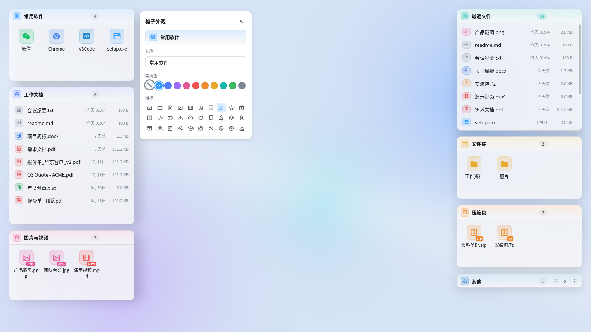
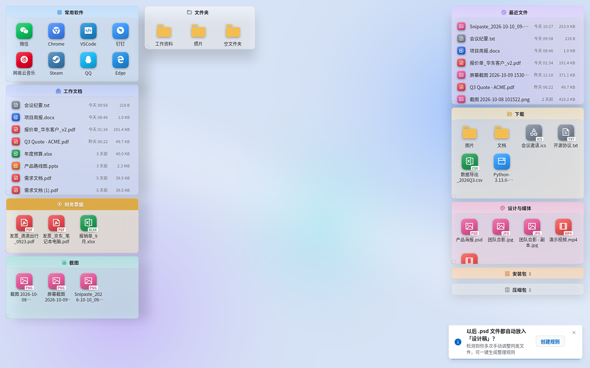

# AI Desktop

**1.3.5** · AI 增强的桌面收纳工具：用围栏、规则和助手整理桌面图标与文件，类似桌面整理类应用的 AI 加强版。

## 界面截图



*浅色桌面整理 / Light-theme organizer*


*深色围栏 / Fences, dark theme*



*浅色围栏 / Fences, light theme*


*引导 / Onboarding*

## 功能特性

- 桌面围栏与图标整理，支持浅色 / 深色主题。
- 引导流程帮助完成初始布局；提供帮助页。
- Electron 桌面应用，构建脚本在 `scripts/`。

## 技术栈

- Electron
- TypeScript
- 自有构建脚本（`scripts/build.mjs`）

## 从源码运行

源码在仓库根目录。本仓库不包含安装包。

```bash
npm install
npm start            # 先构建再启动 Electron
npm test
npm run build
```
详细说明见该目录 README。

## 文档

- [源码 README](README.original.md)

## 许可证

`package.json` 声明为 MIT。仓库根目录未附带 LICENSE 文件。

---

## English

# AI Desktop

**1.3.5** · An AI-enhanced desktop organizer: fences, rules, and an assistant for icons and files — in the spirit of desktop-cleanup apps, with AI on top.

## Screenshots


*浅色桌面整理 / Light-theme organizer*


*深色围栏 / Fences, dark theme*


*浅色围栏 / Fences, light theme*


*引导 / Onboarding*

## Features

- Desktop fences and icon organization, with light and dark themes.
- Onboarding helps set up the initial layout; a help view is included.
- Electron desktop app; build scripts live in `scripts/`.

## Tech stack

- Electron
- TypeScript
- 自有构建脚本（`scripts/build.mjs`）

## Getting started

Source is at the repository root. This repository does not include installers.

```bash
npm install
npm start            # build, then launch Electron
npm test
npm run build
```
See that directory's README for details.

## Documentation

- [源码 README](README.original.md)

## License

`package.json` declares MIT. There is no LICENSE file at the repository root.

