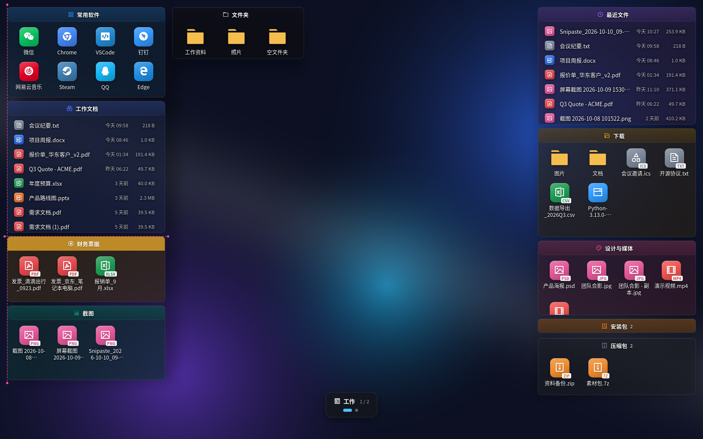
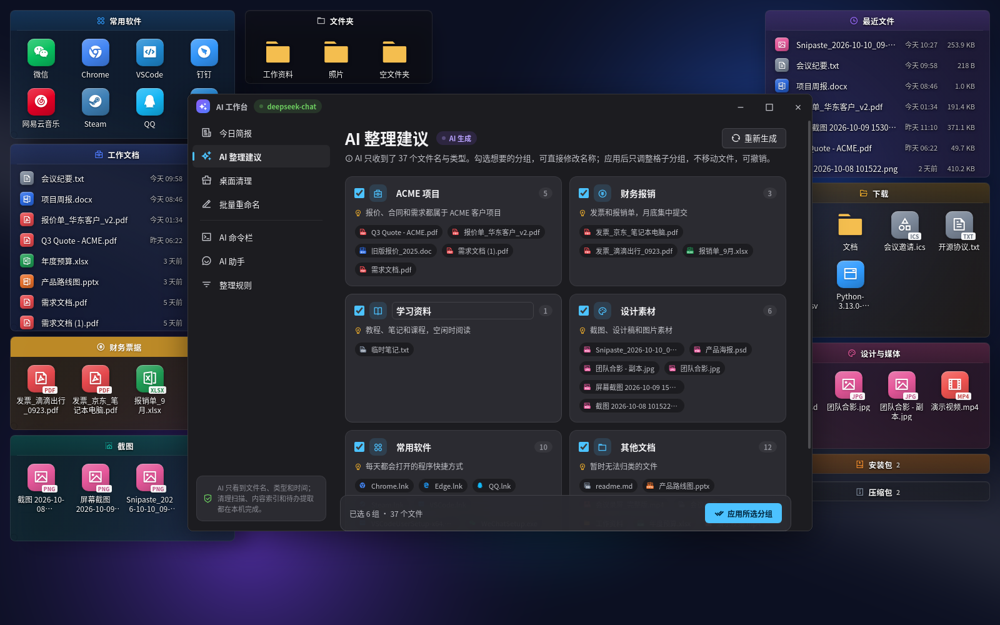
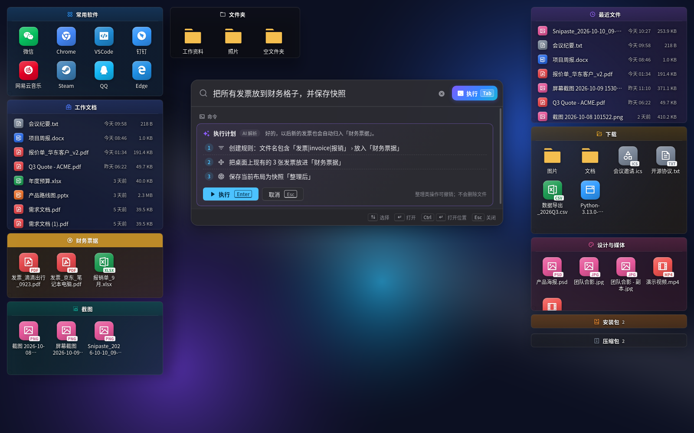
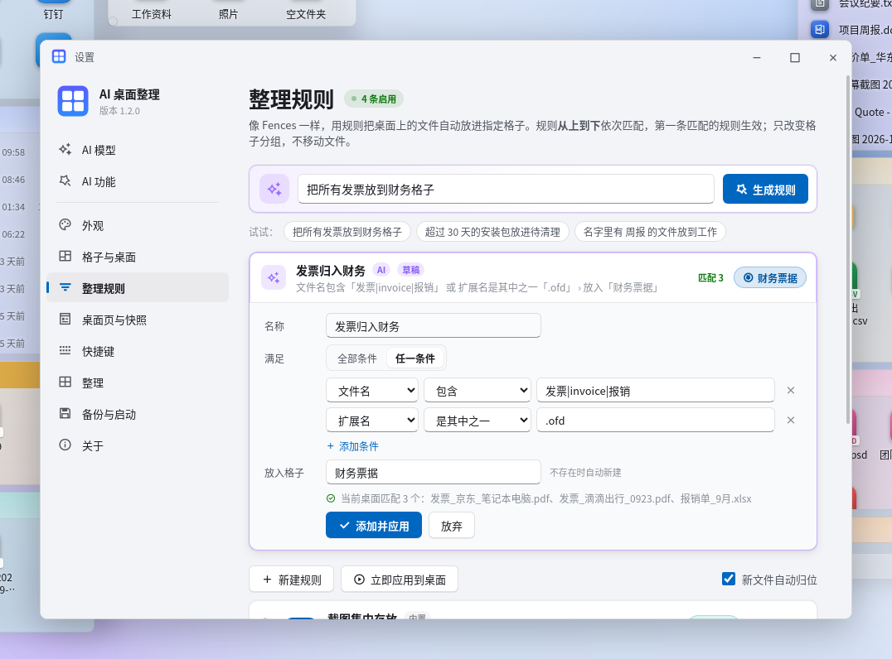
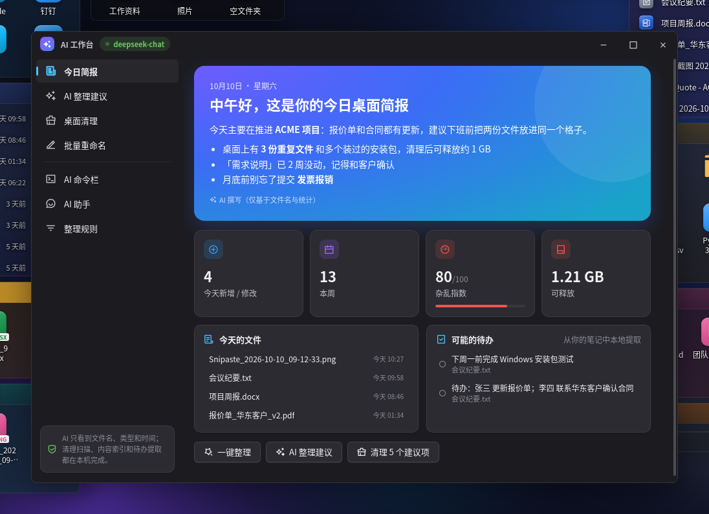
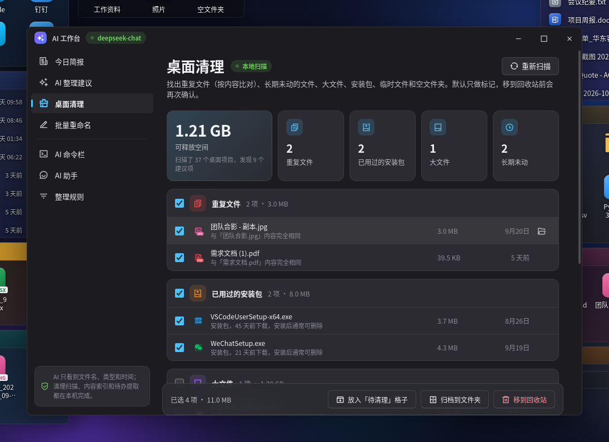
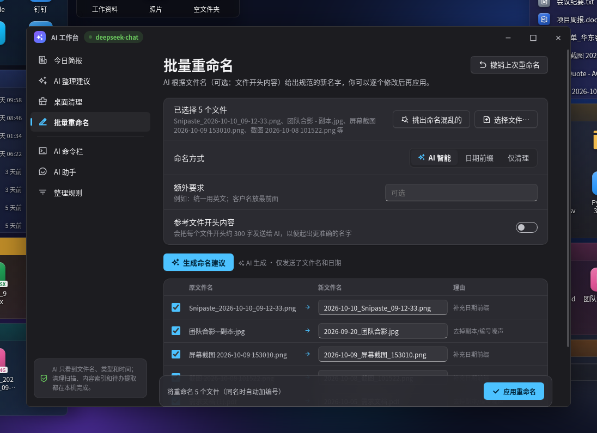
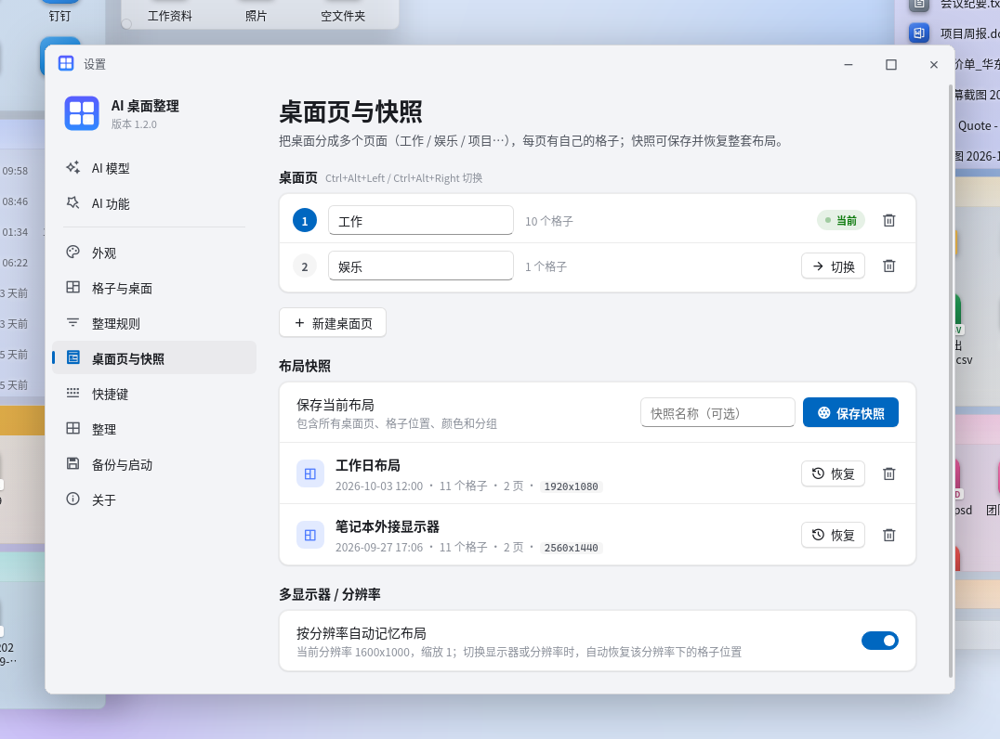

# AI 桌面整理（AI Desktop）v1.2.4

一款对标 Stardock Fences 的 Windows 桌面分区工具，加入 AI 能力：会解释理由的 AI 整理、自然语言规则、桌面清理、AI 命令栏、内容搜索、批量重命名、今日简报。本地优先，没有 API Key 也能用。

技术栈：Electron 31 + TypeScript（原生 DOM）+ esbuild + electron-builder；图标使用本地打包的 Remix Icon 字体（Apache-2.0，离线可用，无 CDN，界面中没有 emoji）。

| Fences 风格 · 深色 | Fences 风格 · 浅色 |
|---|---|
|  |  |

| AI 整理建议 | AI 命令栏 |
|---|---|
|  |  |

| 自然语言规则 | 今日简报 |
|---|---|
|  |  |

| 桌面清理 | 批量重命名 | 桌面页与快照 |
|---|---|---|
|  |  |  |

文档：[AI 功能规划（PRD）](docs/AI功能规划.md)（[PDF](docs/AI功能规划.pdf)）· [Fences 调研笔记](docs/Fences调研.md)

## 1.2.4
- **桌面右键菜单（Windows）**：在桌面空白处右键可打开「AI 桌面整理」级联菜单（HKCU `DesktopBackground\Shell\AIDesktop`），含：新建自定义容器、映射文件夹、一键整理、AI 智能整理、显示/隐藏格子、快速搜索、AI 工作台、保存快照、设置。
- 菜单项通过 `"AIDesktop.exe" --action=…` 启动；已运行时由单实例 `second-instance` 转发到前台实例执行。
- 设置 › 格子与桌面 › **桌面右键菜单** 可开关；关闭时回退为应用内右键菜单（鼠标钩子检测空白桌面）。卸载安装版会清除注册表项。
- 支持的 `--action`：`new-manual-fence`、`map-folder`、`organize`、`ai-organize`、`toggle-hide`、`search`、`settings`、`ai-hub`、`new-snapshot`。

## 1.2.3
- **性能**：启动时先绘制格子外壳再扫描桌面；内容索引延后到首屏之后并以队列让出事件循环；桌面监听 900ms 合并后按脏目录增量刷新；图标并发池 + mtime LRU（256）并跳过超大图缩略图；隐藏的搜索/聊天/帮助窗空闲约 90s 销毁；格子 IPC 数据签名去重；长列表虚拟化 + `content-visibility`；搜索世代号取消过期查询。
- **自定义容器**：托盘/右键「新建自定义容器」——可空格子，拖入默认添加引用（不改磁盘），可从格子移出；菜单可切换放入方式（引用 / 每次询问 / 复制 / 移动）。
- **文件夹映射增强**：「映射文件夹…」可选「仅显示」或「双向同步」；双向模式下拖入写入映射目录（复制/移动需确认），删除进回收站需确认；可随时切换同步方式。
- 启动耗时写入 smoke 日志（`startupMs`）。

## 1.2.2
- **修复**：首次运行新手引导四步内容叠在一起、标题竖排泄漏（命令栏 `.step { display:flex }` 覆盖引导 `display:none`；1.2.1 的 `.ob-step` 重命名仍共用 `.active`）。1.2.2 改为 `.ob-panel[data-step]` + `.is-active`（`display:!important` + `hidden`），侧栏进度点改为 `.ob-dots`，窗口加大并可滚动。
- 快捷键一览：`F1` / `?`（托盘菜单亦可打开）。
- 图标加载并发限制、桌面监听防抖加长、内容索引调度更稳。
- 长文件名折行、搜索空状态、错误 Toast 更久、页码指示器可点左右、设置中 DPI/多显示器说明更清楚。
- README 弱化 `Win+D` / 嵌入桌面表述。

## 1.2 新增

### Fences 风格（对标 Stardock Fences 5/6）
- 低边框半透明面板，标题条居中、白字带阴影；按钮仅在悬停时出现；图标仿系统桌面图标（大图标 + 白字阴影）。
- 每个格子可单独设置：颜色与着色强度、不透明度、标题样式（阴影条 / 极简 / 彩色）、对齐、图标着色（Icon Tint）、锁定位置、快速隐藏时保留。
- **卷起 / 悬停预览**：双击（可改为单击）标题栏卷起成一条标题，鼠标悬停时临时展开。
- **快速隐藏**：双击桌面空白处隐藏/显示全部格子，可同时隐藏系统桌面图标，可按格子设置排除。
- **文件夹映射（Folder Portal）**：格子镜像任意文件夹，可进入子文件夹，带面包屑与返回。
- **规则自动整理**：按扩展名 / 名称关键词 / 正则 / 类型 / 修改时间 / 大小 / 文件或文件夹 编写规则，可调优先级、测试命中数，新文件自动归位。
- **桌面页**：多个桌面页，每页有自己的格子，`Ctrl+Alt+Left / Right` 切换，带页码指示器。
- **布局快照**：保存/恢复命名布局；按屏幕分辨率自动记忆并恢复布局。
- **吸附与对齐参考线**：拖动/缩放时吸附网格、其他格子和屏幕边缘，显示参考线。
- Peek（`Alt+Shift+F`，把格子临时带到所有窗口之上）、变色龙淡出模式。

### AI（见 PRD，P0 全部 + P1 两项）
- **AI 整理建议**：卡片式预览分组，每组给出理由，可改名、勾选后应用，可撤销；会学习你的手动纠正，并提示「以后 .psd 都放进设计稿？」一键生成规则。
- **自然语言规则**：「把所有发票放到财务格子」› 可视化草稿规则 + 当前命中测试 › 添加并应用。
- **AI 命令栏**：在 `Alt+Space` 中直接说「整理桌面并保存快照」，先显示执行计划，确认后执行。
- **内容搜索**：本地全文索引（BM25，中英文），搜索结果中显示「内容匹配」片段；可选配置 embeddings 模型（推荐 Ollama `bge-m3`）做语义混合搜索。
- **桌面清理**：重复文件（按内容比对）、装过的安装包、大文件、长期未动、临时文件、空文件夹；可放入「待清理」格子、归档（可撤销）或移到回收站（二次确认）。
- **批量重命名**：AI / 日期前缀 / 仅清理 三种方式，逐行可改，一键撤销。
- **今日简报**：AI 摘要 + 统计卡（新增、杂乱指数、可释放空间）+ 本地提取的待办；可设为每天首次启动自动打开。
- 所有功能在未配置 AI 时都有本地降级方案；默认只把文件名发送给 AI。

## 功能

### 桌面收纳格子
- 无边框、半透明、不显示在任务栏的格子窗口，展示 `%USERPROFILE%\Desktop` 与公用桌面 `C:\Users\Public\Desktop` 中的文件、文件夹、快捷方式（Windows 上使用系统图标，图片显示缩略图）。
- 拖动标题栏移动、拖动边缘调整大小；折叠 / 展开带动画；鼠标悬停标题栏显示「视图 / 折叠 / 更多」按钮。
- 每个格子可单独设置：**名称、强调色（11 种）、图标（30 个）、视图（图标 / 列表）、排序（手动 / 名称 / 修改时间 / 类型 / 大小）**。右键格子，选择「外观（颜色与图标）」打开外观面板。
- **拖出文件**：把格子里的文件直接拖到资源管理器、微信、浏览器等其他程序（系统原生拖放）；也可以在格子之间拖动、在格子内拖动调整顺序。
- 从资源管理器拖入任意文件，作为「引用」显示（不复制、不移动）。
- **「最近文件」格子**：自动显示桌面上最近修改的文件（数量可调）。
- 双击打开；`Enter` 打开选中项；方向键 / `Home` / `End` 移动选择；`Ctrl`/`Shift` 多选；`Ctrl+A` 全选；`F2` 重命名格子；`Ctrl+Z` 撤销整理。
- **隐藏 / 显示所有格子**：快捷键 `Alt+Shift+D`、单击托盘图标，或（Windows）**双击桌面空白处**。
- 空格子有引导提示；布局保存在 `%APPDATA%\AI Desktop\layout.json`。

### 一键整理与撤销
- 按扩展名分类：文档、图片、视频、音频、压缩包、程序/快捷方式、文件夹、其他。
- 默认**虚拟整理**：只在格子中分组显示，**不会移动或删除任何文件**；手动创建 / AI 创建的格子和「最近文件」格子保持不变。
- 整理、AI 整理、删除格子、重置布局、导入配置都可**撤销**（通知中的「撤销」按钮、托盘菜单、格子右键菜单或 `Ctrl+Z`，最多 15 步）。
- 可选「整理到文件夹（移动文件）」：托盘菜单 › 更多整理。二次确认后，只把用户桌面上的普通文件移动到 `桌面\已整理\<分类>\`（快捷方式、程序、文件夹不移动），并可「撤销上次移动」。

### 快速搜索（默认 `Alt+Space`）
- Spotlight / PowerToys Run 风格的弹出搜索框，随结果数量自动伸缩。
- 搜索桌面（含 3 层子文件夹）文件名，支持**拼音全拼与首字母**（如 `bj` 找到「报价单」，`huiyi` 找到「会议纪要」），匹配字符高亮。
- 自然语言描述（如「上周的那个报价PDF」）会自动用**本地语义解析**（时间词、类型词、关键词）。
- `Tab` 或「AI 查找」按钮：调用大模型做自然语言查找（只发送文件名、类型、修改时间），结果附 AI 理由。
- 方向键选择，`Enter` 打开，`Ctrl+Enter` 打开所在位置，`Esc` 清空 / 关闭。若 `Alt+Space` 被占用，自动回退到 `Ctrl+Alt+Space`。

### AI 功能（OpenAI 兼容接口）
- **AI 智能整理**：根据文件名 / 类型给出 3～8 个按用途划分的格子，确认后应用（虚拟分组，可撤销）。
- **自然语言找文件**：见上。
- **AI 助手面板**（默认 `Alt+Shift+A`）：流式输出与打字指示、Markdown 渲染（标题、列表、引用、代码块一键复制）、消息复制、置顶、建议问题；回形针按钮选择 txt / md / csv / 代码 / **pdf / docx** 文件总结（以文件卡片显示），总结后可继续追问；也可在格子里右键文件，选择「AI 总结此文件」。
- **未配置 Key 时优雅降级**：AI 整理改为规则整理；AI 查找改为本地语义解析；助手面板显示配置引导。

### 设置、引导、通知、备份
- Windows 11 风格设置页：侧边导航（AI 模型 / 外观 / 格子与桌面 / 快捷键 / 整理 / 备份与启动 / 关于）、卡片、开关、分段选择、滑块，**修改即自动保存**；Windows 上使用系统原生标题栏按钮。
- 服务商预设卡片：DeepSeek、通义千问、OpenAI、Kimi、智谱 GLM、硅基流动、Ollama、自定义，并可「测试连接」。
- 主题：跟随系统 / 浅色 / 深色（右键菜单、托盘菜单同步系统主题）；格子不透明度、图标大小可调；Windows 11 可选「亚克力材质」（实验）。
- 快捷键录制（按下组合键即可），显示是否生效 / 被占用。
- **首次运行引导**：4 步（介绍、整理方式、连接 AI、快捷键与选项）。
- **通知**：右下角 Fluent 风格通知，带操作按钮（撤销、打开设置）与倒计时条。
- **导入 / 导出配置**：设置与格子布局保存为 JSON（可选择是否包含 API Key）。
- 托盘菜单：一键整理、AI 智能整理、撤销整理、快速搜索、AI 助手、显示/隐藏格子、格子、更多整理、开机自启、新手引导、设置、退出。

## 配置 AI

托盘菜单 › 设置 › AI 模型：点选服务商卡片，填入 API Key，点击「测试连接」（自动保存）。

| 服务商 | API 地址 | 模型示例 |
|---|---|---|
| DeepSeek | `https://api.deepseek.com/v1` | `deepseek-chat` |
| 通义千问（百炼/DashScope） | `https://dashscope.aliyuncs.com/compatible-mode/v1` | `qwen-plus` |
| OpenAI | `https://api.openai.com/v1` | `gpt-4o-mini` |
| Kimi（Moonshot） | `https://api.moonshot.cn/v1` | `moonshot-v1-8k` |
| 智谱 GLM | `https://open.bigmodel.cn/api/paas/v4` | `glm-4-flash` |
| 硅基流动 | `https://api.siliconflow.cn/v1` | `Qwen/Qwen2.5-7B-Instruct` |
| Ollama（本地，无需 Key） | `http://localhost:11434/v1` | `qwen2.5:7b` |

任何实现了 `/chat/completions` 的 OpenAI 兼容服务都可以使用。

隐私：AI 整理 / 查找只发送文件名、类型、修改时间；只有主动「AI 总结」时才发送该文件的文本。Key 仅保存在本机 `%APPDATA%\AI Desktop\settings.json`（明文 JSON）。

## 安装

- `AI-Desktop-Setup-1.2.4-x64.exe`：安装版（可选择安装目录，创建桌面与开始菜单快捷方式）。
- `AI-Desktop-Portable-1.2.4-x64.exe`：便携版，双击即用。
- `AI-Desktop-1.2.4-win-x64.zip`：解压即用。
- `release/parts/`：安装包的分卷（每卷小于 24 MB，便于邮件 / 聊天工具发送），合并方法见该目录中的 `README-合并说明.txt`。

## 构建

需要 Node.js 18+（已在 Node 20 测试）。

```bash
npm install
npm run typecheck      # TypeScript 类型检查
npm run check:emoji    # 确认界面源码中没有 emoji
npm run build          # esbuild 打包到 dist/（含本地图标字体）
npm start              # 开发运行
npm run dist:win       # 生成 Windows x64：NSIS 安装包 + 便携版 + zip（输出到 out/）
```

在 Linux 上打 Windows 包需要 `wine`（设置 exe 图标 / 生成卸载程序）。建议使用独立的 `WINEPREFIX`：

```bash
WINEPREFIX=/tmp/aidesk-wine npx electron-builder --win nsis portable zip --x64
```

### Linux 开发 / 无头测试
```bash
AI_DESKTOP_DIR=/tmp/demo-desk xvfb-run -a npx electron . --no-sandbox --smoke-test   # 冒烟测试，返回码 0 = 通过
node scripts/mock-ai.mjs 8787                                                         # 本地模拟 OpenAI 兼容服务
# 截图：逐窗口捕获（含透明通道）后合成到生成的壁纸上
AI_DESKTOP_DIR=/tmp/demo-desk xvfb-run -a npx electron . --no-sandbox --capture=/tmp/cap --scene=desktop --search=bj --theme=dark
python3 scripts/compose-shot.py /tmp/cap screenshot-dark.png
```

命令行参数：`--hidden`（开机自启）、`--smoke-test`、`--capture=<目录>`、`--scene=desktop|settings|chat|onboarding`、`--theme=dark|light`、`--search=<词>`、`--toast`、`--appearance`、`--demo-file=<路径>`。

## 项目结构
```
src/main/main.ts       主进程：格子窗口、托盘、快捷键、通知、撤销、导入导出、IPC
src/main/desktop.ts    桌面扫描、分类规则、文件监视
src/main/nlsearch.ts   模糊 + 拼音搜索（pinyin-pro）、本地自然语言解析
src/main/ai.ts         OpenAI 兼容客户端（普通 + 流式）
src/main/extract.ts    txt / pdf / docx 文本提取
src/main/winlayer.ts   Windows 桌面层助手（PowerShell + user32：沉底、嵌入桌面、双击桌面检测）
src/main/config.ts     设置 / 布局 JSON 存储
src/preload/preload.ts 安全桥（contextIsolation + 通道白名单）
src/renderer/*.ts      格子、搜索、AI 助手、设置、外观面板、通知、新手引导
static/style.css       设计系统（颜色 / 圆角 / 间距 / 阴影 / 动效 / 字体变量，深浅主题）
scripts/               构建、模拟 AI、截图合成、emoji 检查
```

## Windows 桌面层与已知限制
- Electron 没有「始终在底层」API。Windows 上格子使用 `type: toolbar`、`skipTaskbar`、不置顶，并启动一个常驻 PowerShell 小助手（内联 C#，调用 `user32.dll`，无需编译原生模块）：
  - 「失焦后沉底」（默认开）：`SetWindowPos(HWND_BOTTOM)`，让格子尽量待在普通窗口下面，贴近桌面体验。
  - 「双击桌面空白处隐藏/显示」（默认开）：低级鼠标钩子检测桌面图标视图上的双击，且双击后没有选中图标时才切换。属于尽力而为，个别系统 / 安全软件可能拦截钩子。
  - 「嵌入桌面（实验，默认关）」：尝试把格子挂到桌面图标所在窗口，使「显示桌面」后仍能看到格子。这是可选增强，并非必需；在部分 Windows 版本（尤其 Win11 较新版本）和多显示器环境下表现不稳定，不推荐作为默认依赖。
- 关于 `Win+D` / 「显示桌面」：未开实验嵌入时，系统会把格子与其它窗口一并最小化，这是正常行为。用托盘图标或 `Alt+Shift+D` 即可重新显示；日常整理不必开启实验嵌入。
- 「亚克力材质」依赖 Windows 11 22H2+，并且与透明窗口的组合在部分显卡驱动上可能无效，默认关闭（默认用半透明背景）。
- 快速隐藏系统桌面图标通过 `ShowWindow` 隐藏桌面图标列表视图实现（尽力而为）；退出程序时会恢复显示。
- 把文件从格子拖到资源管理器时，由资源管理器决定复制或移动（同一磁盘默认移动，与从桌面直接拖动一致）。
- 扫描版 PDF 无法提取文字；`.doc`（旧版 Word）不支持总结。
- 安装包未做代码签名，首次运行可能出现 SmartScreen 提示（更多信息 › 仍要运行）。
- 尚未实现：Fences 6 的格子内标签组（Tabs）、桌面页触控板滑动切换（目前用快捷键 / 托盘 / 带左右按钮的页码指示器）、截图 OCR、剪贴板 AI、智能项目空间（见 PRD 排期）。
- 开发与无头测试在 Linux（Xvfb）上完成，截图为逐窗口捕获后合成到生成的壁纸上；Windows 专用部分（桌面层助手、双击桌面、系统图标、亚克力、开机自启、原生拖出）未在真实 Windows 上验证。
